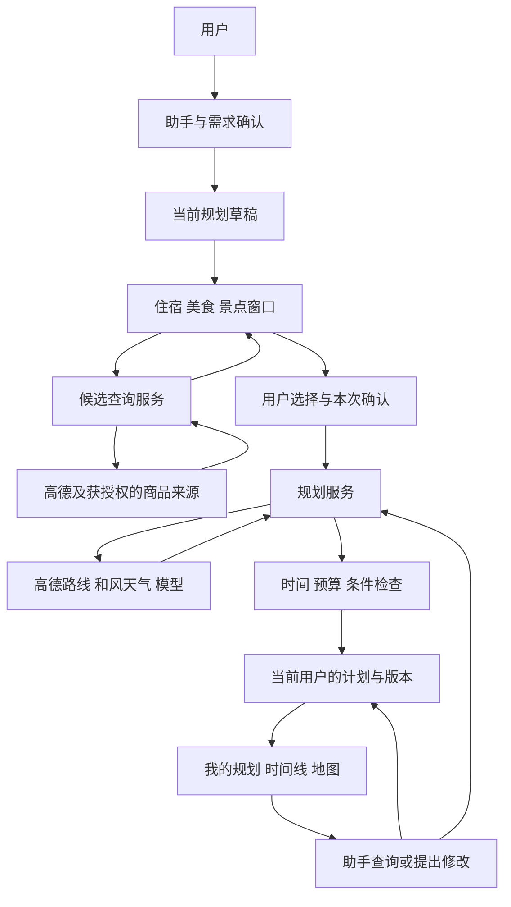

# 旅行助手需求说明书

> 版本：V1.0 需求基线草案  
> 日期：2026-11-04  
> 状态：供四人团队评审和分工使用，尚未开发或验收。  
> 配套文档：[README](README.md)。本文定义产品行为；README 定义公共配置、协作和评测交付约定。  
> 范围说明：以本轮确认的“助手引导选择、保存选择、生成规划”为准。此前文档中涉及支付、外部预订、订单同步、手动标记支付的方案属于历史讨论，本版本不纳入。

## 1. 产品目标与已确认范围

建设一个面向个人游客的 H5 旅行助手，用户通过对话表达住宿、美食和景点预算及偏好，再到对应窗口选择候选项目，确认后生成可查询、修改的旅行规划。

本版本的业务闭环为：

**进入助手 → 收集出行需求 → 用户确认 → 打开对应选择窗口 → 加入规划候选 → 确认本次选择 → 生成行程 → 我的规划查看时间线与地图 → 对话查询或修改。**

已确认事项：

- 旅行助手是前端主要入口，住宿、美食、景点窗口服务于本次规划。
- 收集三类预算需求和偏好，让用户选择，而不是模型替用户直接决定全部项目。
- 不支付、不跳转预订、不获取或同步订单、不记录支付状态。
- 只保存用户选中的项目及完成规划所必需的业务资料，不建立全部商家的镜像库。
- 保留“我的规划”、行程时间线、地图、全部查询、按问题查询和修改能力。
- 高德用于地点、路线与地图；和风用于天气辅助；携程仅作为取得权限后的商品资料来源，不影响基础规划闭环。

本文中的技术栈、三位开发人员职责、登录方案和性能数值是建议基线，团队评审后冻结。供应商账户权限、费用和真实数据能力尚未验收。

## 2. 用户、术语与业务边界

| 术语 | 本项目含义 |
| --- | --- |
| 候选项目 | 用户可选择的一家酒店、餐厅、景点，或具备合法数据来源的具体商品 |
| 地点 | 实际地理位置；同一家酒店可能关联不同房型商品 |
| 选择记录 | 用户明确加入当前规划草稿的项目，尚不等于安排进最终日程 |
| 规划草稿 | 生成前的出行需求、候选选择及用户确认状态 |
| 行程计划 | 已生成的逐日活动、交通、费用估算、来源和提醒 |
| 版本 | 一次成功生成或确认修改后的完整计划，用于比较和恢复 |
| 公共基线 | 三人并行开发前共同遵守且能够启动运行的基础工程与接口约定 |

“商品”是界面候选的统称。高德地点的参考消费不能当作酒店指定房型或景点指定票种的实时售价。本版不以实时商品报价作为核心验收前提；有真实报价时显示条件和查询时间，没有时显示参考价或未知。

正式保存到“我的规划”的建议前提为最小登录和用户隔离。注册、验证码、找回密码不作为本版独立业务目标，可先使用评测账号；正式环境不能把所有访问者视为同一用户。

## 3. 页面、业务流程与数据流

### 3.1 页面结构

| 页面或窗口 | 必须提供的内容与操作 |
| --- | --- |
| 旅行助手 | 对话、需求摘要、补问、打开三个选择窗口、查看候选数量、创建规划、查询与修改入口 |
| 住宿选择 | 城市、入住离店、人数及房间数、预算过滤、地点或商品卡片、加入／移除选择 |
| 美食选择 | 城市或活动区域、饮食偏好、预算、餐厅卡片、加入／移除选择 |
| 景点选择 | 城市、兴趣、预算、景点卡片、加入／移除选择 |
| 规划确认 | 本次输入、勾选项目、日期时段、必选／可选、价格缺失和冲突提示、确认生成 |
| 我的规划列表 | 当前用户计划摘要，打开计划、重命名、删除前确认 |
| 规划详情 | 按天时间线、住宿美食景点地图、预算、来源、提醒、对话查询修改和版本信息 |

“窗口”可采用独立路由页面配合弹层。建议先使用独立路由，方便三类筛选与手机返回操作；界面样式由前端负责人设计，但必须保留 `draft_id` 和已确认条件。

### 3.2 用户流程

1. 用户在助手输入需求，系统识别目的地、日期、同行人数及三类预算。
2. 助手补问关键缺口，用户确认需求摘要。未提供的预算可明确设为不限或暂不确定。
3. 助手给出住宿、美食、景点的选择入口，由用户点击进入，不在每次对话后突然强制跳页。
4. 对应窗口带入本次条件，用户挑选项目。返回助手后，对话、预算、草稿及选择继续保留。
5. 用户可以反复进入窗口增删选择，也可以暂不选择某类。
6. 创建规划时，让用户勾选本次真正使用的候选，并确认日期、数量、必选性及输入假设。
7. 系统检查条件并生成行程；不能安排的必选项目需报告原因，不能静默丢弃。
8. 成功计划进入“我的规划”；用户查看流程和地图，继续查询或提出修改。

### 3.3 数据流示意

外部平台资料仅在授权范围内查询、展示和处理。数据库保存用户业务资料与获准保存的必要引用，不默认保存供应商全部响应或批量下载图片。

## 4. 功能需求

P0 表示本版必需；P1 表示核心流程稳定后扩展，不作为本版交付阻塞项。

| 编号 | 优先级 | 功能及可验收行为 |
| --- | --- | --- |
| FR-01 | P0 | 助手提取出行需求，显示可编辑摘要；每轮补问最多建议 1—3 个关键缺口 |
| FR-02 | P0 | 区分住宿、美食、景点预算，明确单位、人数及日期口径；允许不限和未知 |
| FR-03 | P0 | 从助手进入对应窗口并带入草稿条件；返回后不丢对话上下文和选择 |
| FR-04 | P0 | 三类窗口支持按类别、地区及预算等条件筛选，空结果和未知价格有明确展示 |
| FR-05 | P0 | 用户主动添加／移除候选，同一项目重复添加有明确规则，保存于当前用户和草稿 |
| FR-06 | P0 | 生成前确认使用哪些项目、何时使用、必选或可选；不使用未勾选资料 |
| FR-07 | P0 | 生成逐日活动及交通，包含住宿、用餐或待补充位置、建议时段、休息及预算 |
| FR-08 | P0 | 检查首尾日可用时间、营业限制、交通耗时、总预算与必选条件，冲突需解释 |
| FR-09 | P0 | 我的规划可查看个人列表与完整计划，刷新或重新登录后仍可读取已保存结果 |
| FR-10 | P0 | 地图同时显示住宿、美食、景点，按天切换，卡片与地图位置联动 |
| FR-11 | P0 | 助手支持完整行程查询、个人计划列表查询，以及按日期、类别、地点或预算等条件查询 |
| FR-12 | P0 | 修改先展示建议及影响，用户确认后产生新版本；保留未受影响内容与原成功版本 |
| FR-13 | P0 | 登录身份和用户数据隔离；用户不能通过替换编号访问他人草稿、选择及计划 |
| FR-14 | P0 | 展示价格性质、来源、查询时间及缺失信息，保留必要数据使用说明 |
| FR-15 | P1 | 导出 Markdown、地图导航跳转、更多候选来源和更精细的逐小时天气调整 |

### 4.1 预算与价格规则

- 统一币种基线为 CNY；金额在接口和数据库中使用整数“分”，避免小数计算偏差。
- 住宿预算默认按每间每晚，美食按每人每天，景点按每人本次旅行；界面必须展示单位，不允许模型猜单位。
- 可额外设置全团总预算上限；分类预算与总预算是两层限制，不能把总预算再作为一个费用项目相加。
- 住宿按房间数和实际晚数计算；美食按人数及实际用餐安排计算；景点按票种和适用人数计算。
- 未知为 `null`，不限制通过独立字段表达，0 表示明确的零金额，不可混用。
- 参考消费只用于粗筛和估算；价格未知的项目允许选择，但必须计入未估清单，不能默认为零或宣称预算一定满足。
- 全团估算同时列出已知小计和未知项目；没有来源时不生成虚假的实时报价。

### 4.2 三类窗口筛选与选择规则

住宿需确认入住离店、房间数和区域；美食可按口味、饮食限制及活动区域筛选；景点可按兴趣、是否收费和日期适用性筛选。无法查询的筛选能力不能画成生效控件。

卡片至少展示名称、类别、区域或地址、价格性质、来源、加入规划按钮。图片、评分、营业时间按实际返回显示；缺失时使用无图样式和“暂未获取”，不伪造评分。

选择必须明确所属草稿。一次只默认加入一条选择，重复点击不产生重复行；同一餐厅跨天就餐、同一景点多次使用通过不同使用日期或明确的使用实例区分。选择一间酒店不等于已经选定可订房型。

用户可以不选择某一类，此时询问是否接受留空或后续补充；助手推荐的新地点必须作为建议供确认，不能未经同意写入用户选择。

### 4.3 生成、时间线与地图规则

- 每个最终安排都应追溯到本次确认选择，或用户明确接受的补充建议。
- 可选项目可能因时间不足未安排，须列出未安排原因；必选项目冲突时阻止发布“全部条件满足”的计划。
- 固定预约时段、入住区间、到离时间与交通方式作为约束；未知营业说明标为待核实。
- 住宿点、美食点、景点用不同图标；点击地图点可查看当日对应活动。
- 真实道路路线来自路径查询；只连接坐标时必须标为顺序示意，失败路段标为未验证。
- 天气按目的地日期匹配，超出可用预报范围显示未知；天气不可用时可以生成附说明的规划。
- 未选住宿、资料不全或某一费用未知时允许生成草案，并清楚说明缺口；时间或必选条件存在硬冲突时需要用户调整。

### 4.4 查询与修改规则

| 用户表达 | 系统应做的事 |
| --- | --- |
| “显示这次完整行程” | 读取当前计划全部日期、活动、交通和地图资料 |
| “列出我的全部规划” | 返回当前用户的计划摘要，分页展示，不直接把全部历史内容发给模型 |
| “第二天吃什么、住哪里” | 只读取指定计划第二天相关活动及住宿区间 |
| “哪些项目价格还不确定” | 按价格性质和缺失状态筛选，不查询支付状态 |
| “酒店到景点怎么走” | 读取相应地点与方式，按需查询路线，并说明数据时间 |
| “把第二天午餐换掉” | 指明修改范围，给出候选或引导美食窗口，确认后重算受影响路段和预算 |
| “只改第二天，少走路” | 保留其他日期和仍有效限制；若需要连带调整，先说明并获得确认 |

默认查询当前打开的计划；没有当前计划或有多个可能对象时补问。查询操作不写入数据；模型不能直接执行任意 SQL、代码或访问任意文件。用户确认修改也只影响本系统计划。

## 5. 性能需求

下列为建议验收目标，非已测结果。公共基线评审时确定测试环境、数据规模、样本量和供应商限额；调整指标要留记录。

| 编号 | 场景 | 建议目标与测量边界 |
| --- | --- | --- |
| PF-01 | 点击、发送、加入规划 | 1 秒内反馈处理中、成功或失败，按钮防重复提交 |
| PF-02 | 自有数据查询 | 10 个并发请求下，个人列表与详情接口 P95 不超过 1 秒；不包含外部服务耗时 |
| PF-03 | 自有查询吞吐量 | 在同一测试环境持续 60 秒处理不少于每秒 5 个简单读请求，错误率低于 1%，记录请求总数 |
| PF-04 | 候选与路线外部查询 | 建议整体超时上限 15 秒，失败可重试；响应目标在真实接入后补测确定 |
| PF-05 | 规划生成与修改建议 | 建议单次超时上限 120 秒；展示进行状态；同时生成任务默认限制为 3 个，可配置 |
| PF-06 | 大列表 | 候选、个人计划分页，默认每页 20 条，上限 50；不一次加载所有历史行程 |

P95 指 95% 的请求耗时不超过该值。固定测试数据用于测自有处理能力，真实模型、地图和天气需单独报告；不得把固定返回数据下的速度当作真实供应商表现，不对第三方平台开展未经授权的压力测试。

## 6. 可靠性和可用性需求

| 编号 | 要求 | 验收方式 |
| --- | --- | --- |
| RA-01 | 用户确认添加后由后端持久保存；未保存不得显示保存成功 | 刷新、重新登录后检查选择和计划 |
| RA-02 | 生成失败不损坏原草稿及最近成功计划 | 模拟模型超时与解析失败 |
| RA-03 | 修改有基础版本校验，拒绝过时修改 | 两个客户端基于同一旧版本提交 |
| RA-04 | 添加和确认生成支持防重复 | 重复点击或网络重试不产生重复选择和同一任务的多份计划 |
| RA-05 | H5 在手机与电脑均可完成核心流程 | 至少验证 375px 手机宽度和常规桌面宽度，无主要按钮不可达 |
| RA-06 | 服务失败可解释，部分来源失败可降级 | 显示真实来源可用性，不伪装完整成功 |
| RA-07 | 明确系统状态 | 区分待补充、待选择、待确认、生成中、可用结果、需要调整与失败 |

单服务初期不承诺未经运维验证的全年可用率。发布前应明确数据备份、数据库恢复及服务重启后行为；长期后台任务恢复可按实际架构另行补充。

## 7. 出错处理需求

| 编号 | 情况 | 用户行为与系统处理 |
| --- | --- | --- |
| EH-01 | 日期、人数或预算口径错误 | 标记具体字段并补问，不继续把错误数据传给外部服务 |
| EH-02 | 无候选结果 | 显示空结果，允许放宽区域／预算，不编造商家 |
| EH-03 | 来源无权限或配额不足 | 返回清晰错误；可使用已配置且合法的其他来源，禁止自动冒充真实数据 |
| EH-04 | 位置不明确或同名 | 让用户确认分店、入口或区域，避免错误匹配 |
| EH-05 | 价格／营业／天气缺失 | 明确未知，说明对计划的影响，不填零价或假开放时间 |
| EH-06 | 地图或路线查询失败 | 列表与文字计划仍可查看，路段显示未验证并可重试 |
| EH-07 | 模型格式错误或超时 | 有限重试，达到上限返回失败并保留输入；次数进入公共配置 |
| EH-08 | 版本冲突或确认后草稿已改变 | 要求刷新并重新确认，不能覆盖新版本或沿用旧确认 |
| EH-09 | 登录失效或访问他人资料 | 提示登录或返回统一无权限结果，不泄露他人计划内容 |
| EH-10 | 手机网络断开 | 区分已持久保存与未保存内容，允许安全重试，不误显示成功 |

## 8. 接口需求与共享数据约定

### 8.1 通用约定

- 业务接口前缀 `/api/v1`，JSON 使用 `snake_case`，公开 ID 统一为字符串。
- 日期为 `YYYY-MM-DD`；记录时间为带时区的 ISO 8601 字符串。行程活动按目的地当地时间解释并记录时区。
- 金额使用 `amount_minor` 等“分”字段并附 `currency`；经纬度命名为 `longitude`、`latitude`，同时记录 `coordinate_system`，不靠数组顺序猜测。
- 成功结果：`{"code":"OK","message":"成功","data":{},"request_id":"..."}`；错误结果也含相同顶层字段，错误明细放 `data`。
- HTTP 状态码与业务错误一致：400 请求错误、401 未登录、404 记录不存在或不可访问、409 版本冲突、422 字段校验失败、429 限流、502 上游失败、504 超时。
- 列表结果使用 `items`、`next_cursor`、`has_more`；内部始终按当前用户权限过滤。
- 身份从后端可信会话解析，不以客户端传入的 `user_id` 作为权限依据。
- 修改草稿传 `expected_revision`，修改计划传 `expected_version`，冲突返回 409。
- 模型输出先验证字段，再执行时间、金额和权限规则。SDK 兼容不能替代供应商能力验证。

### 8.2 核心对象

| 对象 | 必要字段与规则 | 数据所有者 |
| --- | --- | --- |
| User | `user_id`；认证方式在公共基线确定 | 成员 B |
| TripDraft | `draft_id`、`revision`、目的地、日期、人数、房间数、预算、偏好、状态 | 成员 B；需求解析由 C 提议 |
| Budget | `currency`、分类上限、单位、是否不限；未知与零分开 | B 定义存取，C 负责计算 |
| CatalogItem | `item_ref`、来源标识、源地点／商品 ID、类别、名称、地点、价格性质及可用信息 | B；临时引用不等于永久建库 |
| Selection | `selection_id`、`draft_id`、来源引用、使用日期、数量、必选性、必要用户备注 | B |
| ConfirmedInput | `confirmation_id`、`draft_id`、`draft_revision`、勾选的选择 ID 及输入快照 | C 协调，B 提供草稿读取 |
| Plan | `plan_id`、`version`、确认输入引用、天数、活动、交通、费用、提醒、来源 | C |
| PlanItem | `plan_item_id`、关联选择 ID、日期、时间、地点、类别、价格及性质 | C |
| RevisionPreview | `preview_id`、`plan_id`、基础版本、变更摘要、影响和到期时间 | C |

预算对象建议包含全团总上限，以及住宿每房晚、美食每人天、景点每人本次上限；具体字段列表由 B 与 C 在公共基线中落为一份共享定义，禁止各自起名。

价格性质至少为 `reference`（参考）、`quoted`（带条件报价）、`user_entered`（用户填写）、`unknown`（未知）。不包含任何支付或订单状态。

`CatalogItem` 返回接口和 `Selection` 可持久保存字段需分别定义。供应商不允许保存的字段只用于获准展示；必要引用能否保存也应事先核实。

### 8.3 接口清单建议

以下均为待实现的接口约定，不表示当前目录存在可运行服务。请求响应示例及错误明细应在公共基线补齐后再启动并行开发。

| 接口 | 用途 | 负责人 |
| --- | --- | --- |
| `POST /auth/login`、`POST /auth/logout`、`GET /auth/me` | 最小登录、退出、当前用户 | B |
| `POST /drafts`、`GET /drafts/{draft_id}`、`PATCH /drafts/{draft_id}` | 新建、读取和确认修改草稿 | B |
| `POST /drafts/{draft_id}/assistant/messages` | 理解需求、补问、返回拟更新字段及选择窗口建议，不擅自提交用户选择 | C |
| `GET /catalog/search` | 携带 `draft_id`、`category` 和分页条件查询候选，读取预算与偏好 | B |
| `GET /catalog/items/{item_ref}` | 查看候选详情；引用失效时提示重新查询 | B |
| `POST /drafts/{draft_id}/selections` | 添加候选，后端校验来源引用和草稿版本 | B |
| `DELETE /drafts/{draft_id}/selections/{selection_id}` | 移除候选，查询参数带 `expected_revision` | B |
| `POST /drafts/{draft_id}/confirm` | 确认本次资料，返回确认编号与草稿版本 | C |
| `POST /plans` | 使用 `draft_id`、`confirmation_id` 和幂等键生成并保存计划 | C |
| `GET /plans`、`GET /plans/{plan_id}` | 当前用户列表与完整详情 | C |
| `GET /plans/{plan_id}/items` | 按日期、类别等筛选活动 | C |
| `POST /plans/{plan_id}/assistant/messages` | 识别查询或修改意图；查询读取数据库，修改返回建议或调用预览 | C |
| `POST /plans/{plan_id}/revisions/preview` | 按基础版本生成修改预览，不替换当前版本 | C |
| `POST /plans/{plan_id}/revisions/{preview_id}/confirm` | 确认并生成新版本，重复确认不重复发布 | C |
| `POST /routes/estimate`、`GET /weather` | 统一提供路线与天气数据 | B，供 C 与 A 使用 |

表内路径均加 `/api/v1` 前缀。计划详情应包含前端绘图所需且获准展示的地点与路段数据，避免前端再次自行推导时间或费用。

幂等键用于识别同一次提交的网络重试：相同用户和相同键返回同一任务或结果，不创建多份计划；相同键但不同输入应报冲突。确认输入只适用于对应草稿版本，生成前须复核。

## 9. 约束与技术边界

- 建议前端 Vue 3 + TypeScript，后端 Python + FastAPI + Pydantic，数据库 MySQL 8.4，数据迁移 Alembic；模型和 HTTP 客户端通过薄封装接入。
- 高德与和风继续沿用，密钥、和风认证私钥及数据库密码仅配置在各自安全环境，不能写入仓库、截图或日志。
- 高德地图前端配置与服务端密钥分开；展示要求、坐标转换、接口权限和许可由 B 记录并验证。
- 携程及其他商品源须有实际授权后接入；先接一条真实数据路径，缺权限时报告，不阻断与之无关的开发。
- 模型品牌、准确型号、数据库驱动和依赖版本在公共基线固定；不要求本版使用复杂多智能体、向量库或微服务。
- 模型只获得本次任务必要资料；不收集身份证、银行卡、支付密码或平台账号密码，不长期记录完整原始对话。
- 个人计划、草稿和选择均有用户归属。演示模式如使用固定用户，必须显式标记并禁止作为正式环境认证方案。
- 本说明书不承诺平台价格、房态、营业和天气在未来不变；未知必须保留。

## 10. 逆向需求：本版明确不做什么

| 编号 | 不做事项 | 验收限制 |
| --- | --- | --- |
| NR-01 | 支付、收款、退款、跳转预订、订单查询或同步 | 页面、接口和数据库不引入相关业务流程 |
| NR-02 | 手动标记已支付／未支付／已预订 | 只记录选择和规划状态，不继承历史支付标签 |
| NR-03 | 把参考消费当实时价格，未知价格当零 | 任何页面与预算合计均不得发生 |
| NR-04 | 默认收集所有浏览记录或批量复制商家库 | 只保存用户选择及必要规划资料，受来源授权约束 |
| NR-05 | 模型未经确认替用户选择或覆盖整份计划 | 补充候选和修改均需符合确认流程 |
| NR-06 | 执行用户任意代码、任意 SQL、越权查询其他用户 | 工具与接口由后端限制并做用户隔离 |
| NR-07 | 自动把假数据冒充真实接口结果 | 演示模式、固定数据测试和真实验收分别标识 |
| NR-08 | 社交社区、商户后台、全世界覆盖、复杂旅游交易 | 不占用本版业务开发任务 |

## 11. 验收与代码评测用例

你作为需求和评测负责人，验收结果建议分为：通过、失败、未验证、因外部条件阻塞。只有真实证据支持的范围才可标通过。

| 编号 | 关联需求 | 场景与预期 |
| --- | --- | --- |
| AC-01 | FR-01/02 | 用户只给总预算时补问分类口径；修改人数后摘要使用新值 |
| AC-02 | FR-02 | 两人住一间房两晚，每晚 300—500 元，住宿合计 600—1000 元，不再乘两个人 |
| AC-03 | FR-02/14 | 未知价与免费项目分别显示；合计为已知小计加未估项目，不以零掩盖缺失 |
| AC-04 | FR-03 | 助手带草稿进入美食窗口，返回后需求、选择和对话上下文一致 |
| AC-05 | FR-04 | 预算筛选有明确单位；查询无结果、无权限和超时分别展示真实状态 |
| AC-06 | FR-05 | 快速重复加入一次不产生重复；明确跨日使用可建立不同实例 |
| AC-07 | FR-06 | 五个候选仅确认三个，计划不擅自使用未确认两个；确认后改草稿会使旧确认失效 |
| AC-08 | FR-07 | 未选餐厅仍可确认留空，不捏造用户选过的餐厅 |
| AC-09 | FR-08 | 首日 18:00 才到达，不在此前安排本地活动；必选时段冲突明确报错 |
| AC-10 | FR-08 | 交通耗时加活动超时，报告冲突或给调整建议，不伪称全部满足 |
| AC-11 | FR-09/13 | 刷新、重新登录可读个人计划；换用户或篡改 ID 无法读取他人资料 |
| AC-12 | FR-10 | 当日酒店、餐厅、景点齐全，卡片与地图点对应正确入口；失败路段标未验证 |
| AC-13 | FR-11 | 完整计划、全部个人计划列表、第二天住宿、未知价项目四类查询均返回对应范围 |
| AC-14 | FR-12 | 只改第二天午餐，确认前旧计划不变；确认后重算受影响交通与预算 |
| AC-15 | FR-12/RA-03 | 两份修改基于相同旧版本，后确认的过时方案返回冲突，不覆盖新版本 |
| AC-16 | RA-02/04 | 生成超时保留原数据；同一幂等键重试不创建多份计划 |
| AC-17 | FR-14 | 天气超范围、营业信息缺失、价格过期均有明确说明 |
| AC-18 | NR-01/02 | 全站无支付、预订和订单同步入口，不存在遗留支付标签 |
| AC-19 | PF/RA-05 | 报告自有查询延迟、吞吐量、错误率及设备范围；手机完整走通核心流程 |
| AC-20 | NR-07 | 真实地图、天气、模型的通过证据与固定测试数据的结果分别列出 |

评测层次：后端规则及权限测试 → 前后端固定数据联调 → 获授权的真实服务验证 → 用户操作验收。发现缺陷后验证对应修复；通过固定数据不能代替真实数据权限、路线或模型验收。

## 12. 四人分工与启动条件

| 角色 | 主责 | 核心交付 |
| --- | --- | --- |
| 你：需求与评测负责人 | 冻结范围、确认公共约定、设计评测、审查证据、组织合并 | 本需求、验收记录、问题清单与阶段结论 |
| 成员 A：H5 前端 | 助手、三类窗口、确认页、我的规划、时间线和地图交互 | 完整用户流程与页面验收证据 |
| 成员 B：业务数据与外部资料 | 最小用户认证、草稿、候选、选择持久化、高德与和风接入 | 稳定数据接口、用户隔离和真实来源验证 |
| 成员 C：规划与对话业务 | 需求解析、确认输入、生成、预算时间检查、计划查询与版本修改 | 规划引擎、查询修改接口及规则测试 |

公共基线建议由 B 主责后端与数据库，A 主责前端启动和共享接口类型，C 主责模型适配与规划对象；你审核范围、接口和验收。公共基线通过后才并行展开业务，避免三个人分别建立不兼容的用户、数据库连接或配置。

开始并行开发前必须具备：新同事按 README 能启动前后端；统一依赖、环境变量和错误格式；数据库迁移可复现；身份接口可用；核心请求响应示例及固定测试数据齐全；每个共享文件有负责人；真实与演示模式明确。

## 13. 当前交付状态

当前仅完成需求与协作设计。没有创建业务工程、配置数据库、申请 Key、调用真实服务、运行应用、执行接口测试或向 GitHub 发布。

团队首先评审本版范围和公共约定，然后通过公共基线检查，三人再按职责开发。技术建议及性能目标经评审通过后成为实施基线；若需求变更，应同步更新本文、README 的接口约定和对应验收用例。
